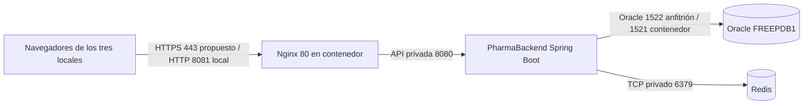

# PharmaBackend

API Spring Boot de PharmaSoft, con Oracle, JWT, permisos y caché Redis. Verificación de la actividad autónoma S13: 8 de noviembre de 2026. Las evidencias se conservan en `docs/s13/capturas-directas`. El informe con las capturas incorporadas está en `docs/informe-s13.pdf` y su versión editable en `docs/informe-s13-final.docx`.

## Despliegue en producción

### Arquitectura y puertos

El entorno medido usa Nginx en `localhost:8081`, backend en `localhost:8080`, Oracle en `localhost:1522` y Redis en `localhost:6379`. El Compose de desarrollo publica Redis para redis-cli; en producción se debe restringir a red privada. Los navegadores solo acceden a Nginx. HTTPS todavía no está configurado en este laboratorio.

### Variables de entorno

No guardar valores reales en Git ni en capturas. Spring no carga automáticamente un archivo `.env` arbitrario al ejecutar el JAR.

| Variable | Propósito |
|---|---|
| `SPRING_PROFILES_ACTIVE` | Seleccionar `prod` |
| `SERVER_PORT` | Puerto HTTP privado del backend |
| `DB_URL` | URL JDBC del servicio Oracle |
| `DB_USERNAME`, `DB_PASSWORD` | Credenciales del usuario Oracle de la aplicación |
| `JWT_SECRET` | Clave Base64 aleatoria de al menos 32 bytes para HS256; mantener estable entre reinicios |
| `JWT_EXPIRACION_MINUTOS` | Vigencia del token; valor predeterminado 30 minutos |
| `FRONTEND_ORIGINS` | Orígenes autorizados si se accede directamente al backend con CORS |
| `REDIS_HOST`, `REDIS_PORT` | Instancia Redis privada compartida por los procesos del mismo despliegue |
| `SPRING_CACHE_REDIS_TIME_TO_LIVE` | Vigencia de seguridad de las entradas; configuración normal `10m` |

Un `.env` puede ser usado por Docker Compose para interpolación; eso no implica que el proceso Java iniciado por separado lo reciba. Usar un gestor de secretos o variables del servicio. No introducir una clave JWT nueva en cada arranque: invalidaría sesiones. En el laboratorio de pruebas se usó una clave temporal distinta de las credenciales del proyecto.

### Construir y desplegar

1. Disponer de Java y Maven compatibles con `pom.xml`, Oracle disponible y el esquema de la aplicación creado. Hacer copia verificable de Oracle antes de cualquier migración. `ddl-auto=validate` valida el esquema; no lo crea. Revisar las migraciones contra una copia antes del despliegue.
2. Ejecutar `./mvnw.cmd clean verify`. Las pruebas usan H2 en perfil test y no sustituyen la validación sobre Oracle/Redis.
3. Conservar el JAR anterior y su configuración en una carpeta de releases fuera de `target`. Detener el servicio Java antes de sustituir el JAR en Windows.
4. Configurar las variables anteriores en el servicio. Para una consola PowerShell: `$env:SPRING_PROFILES_ACTIVE='prod'`, `$env:SERVER_PORT='8080'`; proporcionar DB y JWT mediante variables privadas, sin imprimirlas.
5. Iniciar `java -jar target/PharmaBackend-0.0.1-SNAPSHOT.jar`. Confirmar en la consola el perfil `prod` y el puerto 8080. En producción administrar el proceso como servicio con reinicio automático.
6. Comprobar `/api/health`, `/actuator/health`, login, consulta de productos y una operación autorizada de prueba. El primero solo confirma que la aplicación responde; Actuator incluye la salud de sus dependencias. Con ADMIN revisar componentes y métricas; sin token los detalles permanecen ocultos.
7. Levantar la SPA con Nginx según el README del frontend. No publicar Actuator en Internet; consultar desde la red de administración. El proxy temporal usado para medir fue retirado.

### Volver a la versión anterior

Detener el servicio, restaurar el JAR y la configuración de la release previa y volver a iniciar. Confirmar salud y una consulta antes de reabrir el acceso. La clave JWT debe mantenerse salvo rotación deliberada. Si hubo cambio de esquema, usar un procedimiento de migración inversa validado o restaurar la copia coordinando las escrituras; no asumir que bajar el JAR revierte Oracle. Si cambia la forma serializada de la caché, invalidar solo las claves de PharmaSoft o usar un prefijo versionado; nunca `FLUSHALL` en una instancia compartida.

### Estado de buenas prácticas

| Práctica de la sesión | Estado observado | Acción pendiente |
|---|---|---|
| Features lazy y reporte inicial diferido | Cumple | Vigilar los presupuestos del build |
| Optimización adicional medida | Cumple | Layout lazy reduce Initial total de 318,32 a 311,41 kB en comparación aislada |
| Caché de archivos con hash e index revalidable | Cumple | Desplegar archivos de forma atómica y conservar los anteriores |
| API sin almacenamiento en navegador | Cumple | Mantener los encabezados de Spring Security |
| Redis con TTL e invalidación | Cumple | Repetir matriz al cambiar servicios; TTL normal diez minutos |
| Fallback cuando Redis falla | Cumple | Alerta operativa de degradación; no confundir disponibilidad con salud UP |
| Perfil prod, SQL y bind desactivados | Cumple | Mantener separados los secretos de desarrollo |
| RequestId en log, errores y SPA | Cumple | Incorporar búsqueda centralizada para soporte |
| Logs sin secretos y con rotación | Cumple parcialmente | Auditoría local aprobada; faltan retención central y control de acceso operativo |
| Health y métricas protegidas | Cumple parcialmente | ADMIN controla detalles/métricas; faltan alertas e infraestructura privada definitiva |
| HTTPS | No cumple | Configurar certificado y redirección en el proxy |
| Respaldo y recuperación Oracle | Cumple parcialmente | No se verificó un procedimiento automático ni una restauración de producción |
| Pruebas automatizadas | Cumple | 55 backend y 111 frontend; mantener en CI |

### Tres recomendaciones priorizadas para los tres locales

1. **Antes de abrir acceso remoto:** publicar solo Nginx con HTTPS, certificado renovable y reglas de red. Oracle, Redis y Actuator deben quedar en red privada. No exponer el puerto 6379 usado en el laboratorio.
2. **Antes de operar ventas reales:** automatizar copias de Oracle, probar una restauración y conservar releases para rollback. Definir con la botica el tiempo máximo de interrupción y pérdida aceptable, sin suponer que Redis reemplaza un respaldo.
3. **Para operar los tres locales:** utilizar una API y una base coherentes, Redis compartido por los procesos de esa API y monitoreo central de salud, latencia, errores y caché. Las instancias de Redis independientes por local dejarían copias incoherentes; agregar alertas y responsables de respuesta.

### Evidencias y alcance

Las mediciones del 08/11/2026 corresponden a una sola máquina local y datos de prueba. No permiten estimar capacidad para tres locales ni percentiles bajo carga. El ensayo conservó ventas 122 y 123, producto 73, cliente ficticio 101 y categoría 167 para trazabilidad; eliminó únicamente su categoría vacía 168. El TTL de un minuto y la caída de Redis fueron temporales.

Fuentes: [Angular PreloadAllModules](https://angular.dev/api/router/PreloadAllModules), [esbuild analyzer](https://esbuild.github.io/analyze/), [Spring Security headers](https://docs.spring.io/spring-security/reference/features/exploits/headers.html), [Spring Boot metrics](https://docs.spring.io/spring-boot/reference/actuator/metrics.html).
